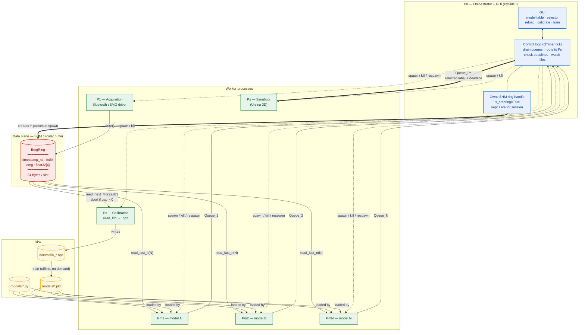

<div align="center">

# sEMG → Signal Analysis → Drone Simulation

**Global architecture & IPC contracts**


</div>

> **Scope.** This document fixes the **global process architecture** and the
> **inter-process contracts** only. The YAML schema, feature-extraction details,
> and model internals are deliberately out of scope and will be defined step by step.

---

## Table of contents

- [1. Overview](#1-overview)
- [2. Process map](#2-process-map)
- [3. Processes](#3-processes)
- [4. IPC contracts](#4-ipc-contracts)
- [5. Model plugin interface](#5-model-plugin-interface)
- [6. Reload semantics](#6-reload-semantics)
- [7. GUI (P0)](#7-gui-p0)
- [8. Decisions log](#8-decisions-log)
- [9. Open items](#9-open-items)
- [10. Reference](#10-reference)

---

## 1. Overview

The system reads **4-channel sEMG** from a Bluetooth sensor, classifies the
wearer's movement, and drives a **simulated drone**. It is built as a **star
topology**:

| Plane | Component | Role |
|:--|:--|:--|
| **Control** | **P0** — orchestrator + GUI | Process lifecycle, model selection, command routing |
| **Data** | **SHM circular buffer** | Single-producer / multi-consumer ring of raw EMG samples |

Every other process is a **pure producer** or a **pure consumer** of one of those
two planes. No process talks to another except through **P0** or through the **ring**.

### Design principles

| # | Principle | Why it matters |
|:-:|:--|:--|
| 1 | **P1 never knows who reads it** | Acquisition writes to the ring and stops. Nobody reading is a valid state. |
| 2 | **Models are independent processes** | Each `Pm_i` reads the same ring and emits its own classification. Models never see each other. |
| 3 | **P0 is the only router** | The simulator never knows a model exists; it only receives the selected model's stream. |
| 4 | **Calibration is a file, not a state** | Once `data/calib_*.npz` exists it is immutable input. Retraining is offline and repeatable. |
| 5 | **Code and weights are separate artifacts** | Editing `model.py` respawns the process; retraining produces a new `.pkl`. Neither implies the other. |
| 6 | **Commands expire** | P0 stamps a deadline on every command. No fresh command before the deadline → the simulator falls back to `rest`. |

> **Principle 6 is the keystone.** It makes model death, model switching, and
> low-confidence output all behave correctly **without any special-case code**.

---

## 2. Process map



**Legend** — `==>` data flow · `-->` read/write · `-.->` process control (spawn/kill)

---

## 3. Processes

### P0 — Orchestrator + GUI

| Responsibility | Detail |
|:--|:--|
| **Read config** | YAML at startup (schema TBD) |
| **Create the ring** | `EmgRing(..., is_creating=True)` — **keeps the handle alive for the whole session**, otherwise the SHM segment may be unlinked |
| **Spawn children** | Passes the ring object (pickled) and each child's own `mp.Queue` at spawn |
| **Control loop** | `QTimer` tick (~50 ms): drain every `Queue_i` non-blocking, update UI state, forward the selected model's label to `Queue_Ps` with a deadline, check deadlines, poll the file watcher |
| **Model selector** | GUI action — changes which `Queue_i` feeds `Queue_Ps` |
| **Reload button** | Diffs model source files against last-loaded hashes; kills and respawns **only** the changed `Pm_i` |
| **Train action** | Spawns a short-lived trainer subprocess, waits, then (re)spawns the `Pm_i` |
| **Calibrate action** | Spawns `Pc`, waits for it to finish, reports success / overflow |

> **Concurrency rule.** The control loop and the GUI must never block each
> other. The loop runs on the Qt timer; the GUI reads a snapshot of state and
> posts commands back. **No blocking calls inside the tick.**

### P1 — Acquisition

- Talks to the Bluetooth sEMG sensor.
- Writes one slot per sample: `write(record)`.
- Knows nothing about consumers. Runs whether or not anyone reads.

### Pc — Calibration

- Spawned on demand by P0, **short-lived**.
- Reads the ring with `read_next_fifo("calib")`.
- **Aborts with an error if `gap > 0`** — a gap means samples were lost and the
  calibration dataset would be silently corrupt.
- Writes `data/calib_*.npz` (format follows the existing `simu_basic` datasets).
- Exits when the user stops the recording.

### Pm_i — Model process (one per model)

Linear lifecycle — **no state machine**:

```text
┌─────────────────────────────────────────────────────────────┐
│  [optional] train from (model.py, data.npz) → weights.pkl   │
│                          ↓                                  │
│                    load weights.pkl                         │
│                          ↓                                  │
│   while True: read_last_n(N) → features → predict → Queue_i │
└─────────────────────────────────────────────────────────────┘
```

Two launch modes:

| Mode | Inputs | Behaviour |
|:--|:--|:--|
| **A — existing weights** | `model.py` + `weights.pkl` | Skips training, goes straight to the loop |
| **B — train then run** | `model.py` + `data.npz` | Trains, writes `weights.pkl`, then enters the loop |

`read_last_n` returns `(structured_array, overrun)`; `overrun` may be ignored
(the model only cares about the most recent window).

### Ps — Simulator

- Ursina 3D app (already prototyped in `simu_basic/main.py`).
- **Never touches the ring.**
- Reads `Queue_Ps` only: `{label, deadline}`.
- Applies the last command until its deadline; on expiry, falls back to `rest`.
- Maps label → drone motion (label vocabulary defined in YAML).

---

## 4. IPC contracts

### 4.1 SHM ring — data plane

Reuses the existing `CircularBuffer` from `new_camera/ring/circular_buffer.py`
**unchanged**. A new `EmgRing` subclass follows the `estimation_ring.py` template.

**Slot layout** — no accelerometer for now:

```python
emg_slot_dtype = np.dtype([
    ('timestamp_ns', np.int64),
    ('emg',          np.float32, (4,)),
])
# item_size = 8 + 16 = 24 bytes
```

> `item_size` is derived from `slot_dtype.itemsize` — **never hand-counted**.

**Consumer usage:**

| Consumer | Method | Returns | Policy |
|:--|:--|:--|:--|
| **P1** | `write(record)` | — | single producer, no lock needed |
| **Pc** | `read_next_fifo("calib")` | `(record, last_seen, gap)` | **abort if `gap > 0`** |
| **Pm_i** | `read_last_n(N)` | `(structured_array, overrun)` | ignore `overrun` |
| **P0** | `read_latest()` | `(record, write_count)` | debug only |

**Lifecycle notes** (from the existing implementation):

- `write_count` is a `Value('Q', 0, lock=False)` and **cannot be attached by
  name** — it must be passed explicitly. P0 creates the ring and passes the
  object to every child at spawn; pickling handles `_view` reattachment via
  `__getstate__` / `__setstate__`.
- `write_count` is **linear and monotonic** — never wraps. This is what makes
  "same slot, new data" unambiguous.
- Reads `.copy()` immediately, so a consumer never sees a half-written slot.

### 4.2 Pm_i → P0 — classification

One `mp.Queue` per model, created by P0 and passed at spawn.

```python
{
    "model":      "svm",      # str   — model name
    "t":          1234.567,   # float — monotonic timestamp (s)
    "label":      "flex",     # str   — from the YAML label vocabulary
    "confidence": 0.87,       # float | None
    "seq":        42,         # int   — per-model counter (detect stalls/drops)
}
```

- `confidence` is optional so threshold-based models can omit it.
- `seq` lets P0 and the GUI detect a stalled model.

### 4.3 P0 → Ps — command

One `mp.Queue`, created by P0.

```python
{
    "label":    "forward",    # str   — from the YAML label vocabulary
    "deadline": 1234.617,     # float — monotonic time after which Ps falls back to rest
    "model":    "svm",        # str   — display / debug only
}
```

> **Expiry semantics.** Ps holds the last command until `now > deadline`, then
> applies `rest`. **P0 stamps the deadline** (it knows the model's expected emit
> rate); Ps only compares against `now`. This is what makes model death, model
> switching, and low-confidence output all behave correctly without special cases.

### 4.4 Pc → disk — calibration dataset

`data/calib_<timestamp>.npz`, following the existing `simu_basic` dataset layout
(produced today by the Shimmer acquisition pipeline).

> Exact keys to be confirmed when the calibration recorder is written. The
> constraint: it must be loadable by the same offline analysis code used on the
> existing `.npz` files.

---

## 5. Model plugin interface

Each `models/<name>.py` must expose a small, fixed surface so P0 can train and
run **any** model generically:

```python
def fit(dataset) -> weights                    # dataset: loaded .npz; returns a picklable object
def load(weights) -> model                     # reconstruct from a .pkl
def predict(window) -> (label, confidence)     # window: structured array from read_last_n
```

| Function | Called by | When |
|:--|:--|:--|
| `fit` | trainer subprocess | Mode B, or the explicit train action |
| `load` + `predict` | long-lived `Pm_i` loop | every inference tick |

> **The model never touches the ring, the queues, or the filesystem.** P0 and
> the `Pm_i` wrapper handle all I/O.

---

## 6. Reload semantics

> **User requirement:** *"I should not have to stop Python, rerun the file,
> re-select the calibration file and reload the model. Just a reload button."*

**Algorithm:**

1. P0 records, per `Pm_i`, the source file path and a **hash** of its contents at spawn.
2. On reload (button press, or file-watcher event), P0 re-hashes every model source.
3. For each changed file: **kill that `Pm_i`**, respawn it **with the same launch
   arguments it had before** (same `model.py`, same `weights.pkl` or `data.npz`).
4. Unchanged models keep running untouched. The ring is untouched (shared memory
   survives process death). The new `Pm_i` reads the ring from "now" onward.

> **Code vs. weights.** A `.py` change **respawns only**. Retraining is a
> separate, explicit action — otherwise every typo fix would kick off a training run.

---

## 7. GUI (P0)

**Framework: PySide6 (Qt)** — chosen because the user wants a real graphical
interface with buttons and windows, not a terminal UI.

**Proposed layout:**

| Area | Content |
|:--|:--|
| **Model table** | One row per `Pm_i` — name, status (running / training / error / stopped), last label, last confidence, age of last message |
| **Selector** | Radio button or dropdown choosing which model feeds Ps |
| **Buttons** | Reload · Start/Stop calibration · Train · Start/Stop acquisition |
| **Status bar** | Ring fill level · P1 sample rate · Ps connection state |

> **Concurrency.** The control loop runs on a `QTimer` tick; the GUI reads a
> snapshot of state and posts commands back. The loop never blocks the UI and the
> UI never blocks the loop.

> **Ps is a separate window** (its own process, its own Ursina window). Keeping
> it separate avoids coupling the 3D engine to the orchestrator.

---

## 8. Decisions log

| # | Decision | Rationale |
|:-:|:--|:--|
| 1 | Star topology: P0 control plane, SHM ring data plane | Decouples acquisition from analysis; models are independent |
| 2 | Ps never reads the ring | Simulator stays dumb; P0 is the only router |
| 3 | One `mp.Queue` per `Pm_i` | P0 knows the sender without parsing; a dead model can't corrupt another's stream |
| 4 | `mp.Queue` for Pm→P0 and P0→Ps | Message rates are a few Hz; queues are trivially sufficient |
| 5 | Linear Pm lifecycle, no state machine | Calibration is a file; the model loop is just train → load → loop |
| 6 | Two launch modes (existing weights / train-then-run) | Matches the user's workflow exactly |
| 7 | Reload = diff + respawn changed `Pm_i` only | No Python restart, no re-selecting files; robust vs. in-process reload |
| 8 | Code and weights are separate artifacts | Editing code shouldn't trigger training |
| 9 | Command expiry with deadline stamped by P0 | Handles model death, switching, and low confidence uniformly |
| 10 | Discrete label vocabulary defined in YAML | Labels must be fixed before running; images optional for the GUI |
| 11 | No accelerometer for now | Deferred; a second ring later is cheap thanks to the existing timestamp-matching pattern |
| 12 | Slot: `timestamp_ns int64, emg float32[4]` | 24 bytes/slot; `item_size` derived from dtype |
| 13 | Reuse existing `CircularBuffer` unchanged | It already provides `gap` and `overrun`; no ring changes needed |
| 14 | PySide6 for P0 GUI | User wants a graphical interface, not a terminal |
| 15 | Ps stays a separate process/window | Avoids coupling the 3D engine to the orchestrator |

---

## 9. Open items

| Item | Status | Notes |
|:--|:--|:--|
| **YAML schema** | deferred | To be defined step by step |
| **Label vocabulary** | open | Concrete list (e.g. `rest`, `forward`, `back`, `left`, `right`, `up`, `down`) + image paths |
| **Calibration `.npz` keys** | open | Align with existing `simu_basic` datasets when the recorder is written |
| **Feature extraction** | open | Shared across models (recommended) vs. per-model |
| **Model hot-reload trigger** | open | Button only, or also a file watcher? (Same mechanism, different trigger) |
| **Ps label → motion mapping** | open | Where it lives (YAML vs. Ps code) |

---

## 10. Reference

| Resource | Path |
|:--|:--|
| Ring buffer documentation | `Repo/CircularBuffer.md` |
| Ring implementation | `new_camera/ring/` — `circular_buffer.py`, `estimation_ring.py`, `frame_ring.py` |
| Existing simulator prototype | `simu_basic/main.py` (Ursina) |
| Existing datasets | `simu_basic/*.npz` (Shimmer EMG, 15 per class) |

---

<div align="center">
<sub>Design agreed · no code written yet · see <a href="#9-open-items">Open items</a> for what's next</sub>
</div>
