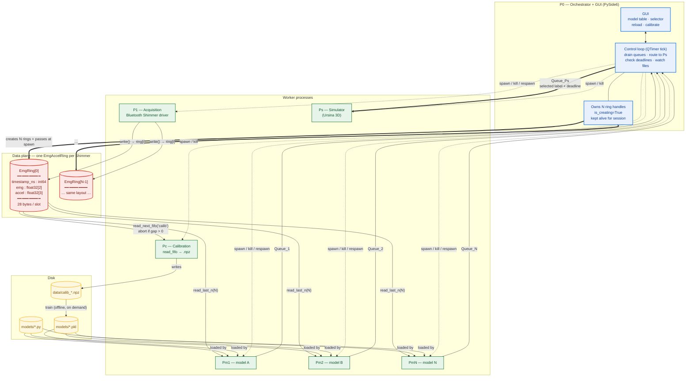

<div align="center">

# sEMG → Signal Analysis → Drone Simulation

**Global architecture & IPC contracts**


</div>

> **Scope.** This document fixes the **global process architecture** and the
> **inter-process contracts** only. The calibration file layout,
> feature-extraction details, and model internals are deliberately out of scope
> and will be defined step by step. There is no central config file: each
> model's label vocabulary travels with its calibration dataset.

---

## Table of contents

- [1. Overview](#1-overview)
- [2. Process map](#2-process-map)
- [3. Processes](#3-processes)
- [4. IPC contracts](#4-ipc-contracts)
- [5. Model plugin interface](#5-model-plugin-interface)
- [6. Reload semantics](#6-reload-semantics)
- [7. GUI (P0)](#7-gui-p0)
- [8. Decisions log](#8-decisions-log)
- [9. Open items](#9-open-items)
- [10. Reference](#10-reference)

---

## 1. Overview

The system reads **sEMG + low-noise accelerometer** from one or more Bluetooth
Shimmer sensors, classifies the wearer's movement, and drives a **simulated
drone**. It is built as a **star topology**:

| Plane | Component | Role |
|:--|:--|:--|
| **Data** | **SHM circular buffers** | **One ring per Shimmer** — single-producer / multi-consumer |
| **Control** | **P0** — orchestrator + GUI | Process lifecycle, model selection, command routing |

Every other process is a **pure producer** or a **pure consumer** of one of those
two planes. No process talks to another except through **P0** or through the **rings**.

### Sensors and rings

Each Shimmer exposes **2 EMG channels + a 3-axis low-noise accelerometer**.
Acquisition writes that pair into **one `EmgAccelRing` per Shimmer**:

| Ring | Slot | Size | Feeds |
|:--|:--|--:|:--|
| `EmgAccelRing` × N | `timestamp_ns`, `emg[2]`, `accel[3]` | 28 B | models |
| `ImuRing` × N | `timestamp_ns`, `accel[3]`, `gyro[3]`, `mag[3]` | 44 B | orientation (Madgwick) — later |

`N = NUMBER_SHIMMER`, a constant (default **1** for the current tests).

`EmgAccelRing` **duplicates** the accelerometer (it is also in `ImuRing`) on
purpose: a model reads its whole window from ONE ring, avoiding a cross-ring
timestamp join and avoiding copying gyro/mag bytes it would discard.

### Design principles

| # | Principle | Why it matters |
|:-:|:--|:--|
| 1 | **P1 never knows who reads it** | Acquisition writes to the ring and stops. Nobody reading is a valid state. |
| 2 | **Models are independent processes** | Each `Pm_i` reads the same ring and emits its own classification. Models never see each other. |
| 3 | **P0 is the only router** | The simulator never knows a model exists; it only receives the selected model's stream. |
| 4 | **Calibration is a file, not a state** | Once `data/calib_*.npz` exists it is immutable input. Retraining is offline and repeatable. |
| 5 | **Code and weights are separate artifacts** | Editing `model.py` respawns the process; retraining produces a new `.pkl`. Neither implies the other. |
| 6 | **Commands expire** | P0 stamps a deadline on every command. No fresh command before the deadline → the simulator falls back to `rest`. |

> **Principle 6 is the keystone.** It makes model death, model switching, and
> low-confidence output all behave correctly **without any special-case code**.

---

## 2. Process map



**Legend** — `==>` data flow · `-->` read/write · `-.->` process control (spawn/kill)

---

## 3. Processes

### P0 — Orchestrator + GUI

| Responsibility | Detail |
|:--|:--|
| **Constants** | `NUMBER_SHIMMER`, tick interval, ring capacity are module-level constants — no config file |
| **Create the rings** | `EmgAccelRing(f"emg_ring_{i}", …, is_creating=True)` for `i in range(NUMBER_SHIMMER)` — **keeps every handle alive for the whole session**, otherwise the SHM segments may be unlinked |
| **Spawn children** | Passes the ring objects (pickled) and each child's own `mp.Queue` at spawn |
| **Control loop** | `QTimer` tick (~50 ms): drain every `Queue_i` non-blocking, update UI state, forward the selected model's label to `Queue_Ps` with a deadline, check deadlines, poll the file watcher |
| **Model selector** | GUI action — changes which `Queue_i` feeds `Queue_Ps` |
| **Reload button** | Diffs model source files against last-loaded hashes; kills and respawns **only** the changed `Pm_i` |
| **Train action** | Spawns a short-lived trainer subprocess, waits, then (re)spawns the `Pm_i` |
| **Calibrate action** | Spawns `Pc`, waits for it to finish, reports success / overflow |

> **Concurrency rule.** The control loop and the GUI must never block each
> other. The loop runs on the Qt timer; the GUI reads a snapshot of state and
> posts commands back. **No blocking calls inside the tick.**

### P1 — Acquisition

- Talks to the Bluetooth Shimmer sensor(s), `NUMBER_SHIMMER` of them.
- Owns **one `EmgAccelRing` per Shimmer**; for each sample it calls
  `ring[i].write(record)` with `emg[2]` and `accel[3]`.
- A ring's name carries its index: `emg_ring_0`, `emg_ring_1`, …
- Knows nothing about consumers. Runs whether or not anyone reads.

### Pc — Calibration

- Spawned on demand by P0, **short-lived**.
- Reads the ring with `read_next_fifo("calib")`.
- **Aborts with an error if `gap > 0`** — a gap means samples were lost and the
  calibration dataset would be silently corrupt.
- Writes `data/calib_<model>_<timestamp>.npz` (see §4.4).
- Exits when the user stops the recording.

### Pm_i — Model process (one per model)

Linear lifecycle — **no state machine**:

```text
┌─────────────────────────────────────────────────────────────┐
│  [optional] train from (model.py, data.npz) → weights.pkl   │
│                          ↓                                  │
│                    load weights.pkl                         │
│                          ↓                                  │
│   while True: read_last_n(N) → features → predict → Queue_i │
└─────────────────────────────────────────────────────────────┘
```

Two launch modes:

| Mode | Inputs | Behaviour |
|:--|:--|:--|
| **A — existing weights** | `model.py` + `weights.pkl` | Skips training, goes straight to the loop |
| **B — train then run** | `model.py` + `data.npz` | Trains, writes `weights.pkl`, then enters the loop |

`read_last_n` returns `(structured_array, overrun)`; `overrun` may be ignored
(the model only cares about the most recent window).

> **The model's label set is read from its own `.npz`.** Two models may
> legitimately use different gesture lists; nothing global fixes them.

### Ps — Simulator

- Ursina 3D app (already prototyped in `simu_basic/main.py`).
- **Never touches the rings.**
- Reads `Queue_Ps` only: `{label, deadline}`.
- Applies the last command until its deadline; on expiry, falls back to `rest`.
- Maps label → drone motion (label set defined by Ps, see §9).

---

## 4. IPC contracts

### 4.1 SHM rings — data plane

Reuses `utils/circular_buffer.py` and the typed layer `utils/shimmer_ring.py`
**unchanged**. The concrete rings already exist: `EmgAccelRing` and `ImuRing`.

**Slot layout — one ring per Shimmer** (already implemented in
`utils/emg_accel_ring.py`):

```python
EMG_ACCEL_DTYPE = np.dtype([
    ('timestamp_ns', np.int64),
    ('emg',          np.float32, (2,)),   # 2 EMG channels (Shimmer ExG chip 1)
    ('accel',        np.float32, (3,)),   # low-noise accelerometer
])
# item_size = 8 + 8 + 12 = 28 bytes
```

> `item_size` is derived from `slot_dtype.itemsize` — **never hand-counted**.

**How many rings.** `NUMBER_SHIMMER` (default 1) → that many `EmgAccelRing`s,
named `emg_ring_0 … emg_ring_{NUMBER_SHIMMER-1}`. The count is a constant owned
by P0, not a config file.

**Consumer usage** (per ring index `i`):

| Consumer | Method | Returns | Policy |
|:--|:--|:--|:--|
| **P1** | `write(record)` | — | single producer, no lock needed |
| **Pc** | `read_next_fifo("calib")` | `(record, last_seen, gap)` | **abort if `gap > 0`** |
| **Pm_i** | `read_last_n(N)` | `(structured_array, overrun)` | ignore `overrun` |
| **P0** | `read_latest()` | `(record, write_count)` | debug only |

**Lifecycle notes** (from the existing implementation):

- `write_count` is a `Value('Q', 0, lock=False)` and **cannot be attached by
  name** — it must be passed explicitly. P0 creates each ring and passes the
  objects to every child at spawn; pickling handles `_view` reattachment via
  `__getstate__` / `__setstate__`.
- `write_count` is **linear and monotonic** — never wraps. This is what makes
  "same slot, new data" unambiguous.
- Reads `.copy()` immediately, so a consumer never sees a half-written slot.

### 4.2 Pm_i → P0 — classification

One `mp.Queue` per model, created by P0 and passed at spawn.

```python
{
    "model":      "svm",      # str   — model name
    "t":          1234.567,   # float — monotonic timestamp (s)
    "label":      "flex",     # str   — from the model's own calibration vocabulary
    "confidence": 0.87,       # float | None
    "seq":        42,         # int   — per-model counter (detect stalls/drops)
}
```

- `confidence` is optional so threshold-based models can omit it.
- `seq` lets P0 and the GUI detect a stalled model.

### 4.3 P0 → Ps — command

One `mp.Queue`, created by P0.

```python
{
    "label":    "forward",    # str   — must exist in the producing model's vocabulary
    "deadline": 1234.617,     # float — monotonic time after which Ps falls back to rest
    "model":    "svm",        # str   — display / debug only
}
```

> **Expiry semantics.** Ps holds the last command until `now > deadline`, then
> applies `rest`. **P0 stamps the deadline** (it knows the model's expected emit
> rate); Ps only compares against `now`. This is what makes model death, model
> switching, and low-confidence output all behave correctly without special cases.

### 4.4 Calibration *configuration* file (the recipe)

Before Pc records anything, the run is described by a **configuration file**
(an editable "recipe") stored as JSON under `calibrations/<name>.json`. It is
the opposite of the immutable dataset in 4.5: cheap to edit, reused across
runs, and version-controlled. The **Configure calibration** window edits it;
Pc reads it to know what to record.

Field | Meaning
--- | ---
`name` | Human label for the recipe (also the default file stem).
`movement_time_s` | Seconds each gesture is held before the recording moves on.
`rest_time_s` | Seconds of `rest` inserted between two gesture slots.
`default_repetitions` | **Global** number of times each gesture is performed. The window shows one field and bulk-applies it to every gesture row; each row may still carry its own count.
`noise_enabled` | If true, the built-in `noise` gesture is added to the label set (enables a `rest → noise → rest` slot).
`gestures[]` | Ordered user gestures: `{name, image, repetitions}`. `image` is a bare filename resolved against `images/`; it is a preview only, not part of the dataset.

Constraints: `movement_time_s`, `rest_time_s` and `default_repetitions` must be positive; gesture names must be non-empty and unique; a missing image is a warning, not an error. The label vocabulary of the eventual dataset is derived from this recipe (every gesture, then `rest` last, with `noise` only when enabled) and frozen into the `.npz` by Pc — see 4.5.

> This is *not* a global config that all models share. Each recipe produces a
> per-model dataset, and the model reads its vocabulary from that dataset.

### 4.5 Pc → disk — calibration dataset

`data/calib_<model>_<timestamp>.npz`.

**The dataset owns the label vocabulary.** Each capture records the gesture list
for *that* model — `calib_svm.npz` may hold 5 gestures, `calib_cnn.npz` 6.
There is no global vocabulary: the label set is derived from the recipe
(4.4) and frozen into this dataset, so two models are allowed to disagree,
which is what makes experimenting cheap.

Constraints on the file:

- `labels` — the ordered list of gesture names used in this capture.
- A `rest` label **must** be present in every dataset: it is Ps's fallback when
  a command expires (§4.3).
- Raw windows + labels + block ids, loadable by the existing offline code.

> Current keys in `hand_gesture_recognition_v1.py` are `X`, `y`, `blocks`,
> `sampling_rate`, `labels_map`; the recorder should stay compatible with them.

---

## 5. Model plugin interface

Each `models/<name>.py` must expose a small, fixed surface so P0 can train and
run **any** model generically:

```python
def fit(dataset) -> weights                    # dataset: loaded .npz; returns a picklable object
def load(weights) -> model                     # reconstruct from a .pkl
def predict(window) -> (label, confidence)     # window: structured array from read_last_n
```

| Function | Called by | When |
|:--|:--|:--|
| `fit` | trainer subprocess | Mode B, or the explicit train action |
| `load` + `predict` | long-lived `Pm_i` loop | every inference tick |

> **The model never touches the ring, the queues, or the filesystem.** P0 and
> the `Pm_i` wrapper handle all I/O.

---

## 6. Reload semantics

> **User requirement:** *"I should not have to stop Python, rerun the file,
> re-select the calibration file and reload the model. Just a reload button."*

**Algorithm:**

1. P0 records, per `Pm_i`, the source file path and a **hash** of its contents at spawn.
2. On reload (button press, or file-watcher event), P0 re-hashes every model source.
3. For each changed file: **kill that `Pm_i`**, respawn it **with the same launch
   arguments it had before** (same `model.py`, same `weights.pkl` or `data.npz`).
4. Unchanged models keep running untouched. The rings are untouched (shared
   memory survives process death). The new `Pm_i` reads from "now" onward.

> **Code vs. weights.** A `.py` change **respawns only**. Retraining is a
> separate, explicit action — otherwise every typo fix would kick off a training run.

---

## 7. GUI (P0)

**Framework: PySide6 (Qt)** — chosen because the user wants a real graphical
interface with buttons and windows, not a terminal UI.

**Layout:**

| Area | Content |
|:--|:--|
| **Model table** | One row per `Pm_i` — name, status (running / training / error / stopped), last label, last confidence, age of last message |
| **Selector** | Dropdown choosing which model feeds Ps |
| **Buttons** | Reload · Start/Stop calibration · Configure calibration… · Start/Stop acquisition · Start/Stop simulator · Open simulation view |
| **Status bar** | One **`Sensor <i>:`** chip per Shimmer (offline / connecting / online / error, colour-coded) · Ps connection state. Ring fill and P1 rate were **dropped** — internal buffer plumbing, not operator-facing (see [`P1_WIRING.md`](P1_WIRING.md) §4) |

> **Concurrency.** The control loop runs on a `QTimer` tick; the GUI reads a
> snapshot of state and posts commands back. The loop never blocks the UI and the
> UI never blocks the loop.

> **Ps is a separate window** (its own process, its own Ursina window). Keeping
> it separate avoids coupling the 3D engine to the orchestrator.

---

## 8. Decisions log

| # | Decision | Rationale |
|:-:|:--|:--|
| 1 | Star topology: P0 control plane, SHM rings data plane | Decouples acquisition from analysis; models are independent |
| 2 | Ps never reads the rings | Simulator stays dumb; P0 is the only router |
| 3 | One `mp.Queue` per `Pm_i` | P0 knows the sender without parsing; a dead model can't corrupt another's stream |
| 4 | `mp.Queue` for Pm→P0 and P0→Ps | Message rates are a few Hz; queues are trivially sufficient |
| 5 | Linear Pm lifecycle, no state machine | Calibration is a file; the model loop is just train → load → loop |
| 6 | Two launch modes (existing weights / train-then-run) | Matches the user's workflow exactly |
| 7 | Reload = diff + respawn changed `Pm_i` only | No Python restart, no re-selecting files; robust vs. in-process reload |
| 8 | Code and weights are separate artifacts | Editing code shouldn't trigger training |
| 9 | Command expiry with deadline stamped by P0 | Handles model death, switching, and low confidence uniformly |
| 10 | **Label vocabulary lives in the calibration `.npz`, per model** | Two models may legitimately use different gesture sets; the model reads its vocabulary from its own dataset, so nothing global must stay in sync |
| 11 | **`EmgAccelRing` duplicates the accelerometer** | A model reads its whole window (2 EMG + 3 accel) from ONE ring — no cross-ring timestamp join, no copying gyro/mag bytes it would discard |
| 12 | **Slot: `timestamp_ns int64, emg float32[2], accel float32[3]`** | **28 bytes/slot**; `item_size` derived from `dtype.itemsize`. Matches `utils/emg_accel_ring.py` |
| 12b | **One ring per Shimmer (`NUMBER_SHIMMER`)** | Horizontal scaling without changing the slot layout; `N = 1` for current tests |
| 13 | Reuse `CircularBuffer` unchanged | It already provides `gap` and `overrun`; no ring changes needed |
| 14 | PySide6 for P0 GUI | User wants a graphical interface, not a terminal |
| 15 | Ps stays a separate process/window | Avoids coupling the 3D engine to the orchestrator |
| 16 | **Shared code lives in `utils/`** | The tested ring layer already lives there; the role is what matters, not the folder name |
| 17 | **No central config file — constants hardcoded** | Keeps `python -m p0` runnable with zero setup; `NUMBER_SHIMMER`, tick interval, ring capacity sit at the top of their owning module |
| 18 | **Per-Shimmer sensor health in the status bar** | One `Sensor <i>:` chip per Shimmer, built from `SystemSnapshot.p1_states`; a single dead Shimmer is visible next to a healthy one. Count comes from the snapshot, so the window never needs `NUMBER_SHIMMER` (see [`P1_WIRING.md`](P1_WIRING.md) §4) |
| 19 | **Child errors cross the process boundary over a `Pipe`, not a `Queue`** | `Queue.put` flushes on a background thread that can lose the message when the child re-raises and exits; `Pipe.send` is synchronous, so the failure reliably reaches the GUI (see [`P1_WIRING.md`](P1_WIRING.md) §4) |
| 20 | **P0 owns the rings and `join()`s P1 before unlinking** | A child still mapping the segment must be gone before `unlink()`, else the segment leaks; a stale-unlink on startup clears segments left by a crashed previous P0 (see [`P1_WIRING.md`](P1_WIRING.md) §2, §5) |

---

## 9. Open items

| Item | Status | Notes |
|:--|:--|:--|
| **Multi-Shimmer windows (`N > 1`)** | open | A model's window must span all rings: per-Shimmer read + timestamp join, or an extra combined ring written by P1. `N = 1` today, so deferred |
| **Calibration `.npz` keys** | open | Must include the per-model `labels` list and guarantee `rest`. Align with `hand_gesture_recognition_v1.py` (`X`, `y`, `blocks`, `sampling_rate`, `labels_map`) |
| **Feature extraction** | open | Shared across models (recommended) vs. per-model |
| **Model hot-reload trigger** | open | Button only, or also a file watcher? (Same mechanism, different trigger) |
| **Ps label → motion mapping** | open | Where it lives (Ps code vs. dataset metadata) |

---

## 10. Reference

| Resource | Path |
|:--|:--|
| Ring implementation | `utils/circular_buffer.py`, `utils/shimmer_ring.py`, `utils/emg_accel_ring.py`, `utils/imu_ring.py` |
| Ring tests | `tests/test_shimmer_ring.py` |
| Existing Shimmer → LSL prototypes | `shimmers/shimmer_emg_lsl.py`, `shimmers/shimmer_imu_emg_lsl.py` |
| Existing offline pipeline (dataset keys to match) | `hand_gesture_recognition_v1.py` |

---

<div align="center">
<sub>Design agreed · see <a href="#9-open-items">Open items</a> for what's next</sub>
</div>
