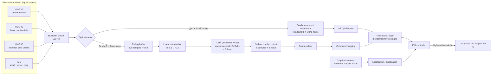
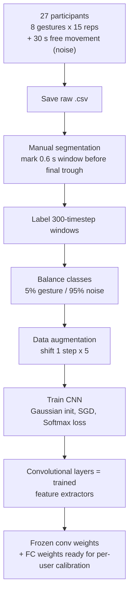
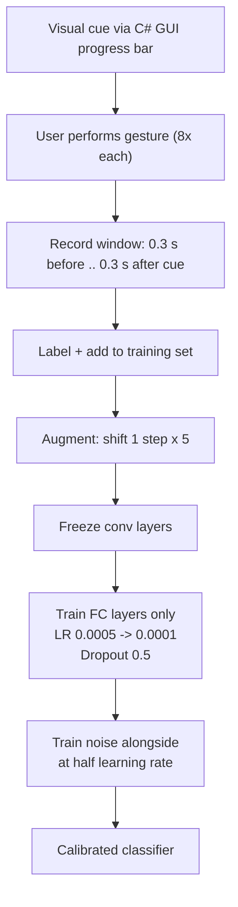
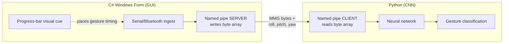

# Dataflow — *Hand Gesture Recognition with CNNs for the Multimodal UAV Control*

Ma, Liu, Jin, Yuan, Sekha, Wilson, Vaidyanathan — *2017 Workshop on Research, Education and Development of Unmanned Aerial Systems (RED-UAS)*.

This document summarizes **how data moves through the system** described in the paper: from the wearable sensors, through the CNN classifier, to the flight commands sent to the UAVs. It covers three flows — **offline training**, **per-user calibration**, and **real-time inference/control**.

---

## 1. At a glance

The system is a **wearable armband** with **1 IMU + 3 MMG sensors** that streams over **Bluetooth at 500 Hz**.

- **MMG channels → CNN classifier → gesture class → discrete UAV commands.**
- **IMU axes → orientation (roll/pitch/yaw) → continuous translational movement target → PID flight control.**

Two processes are bridged by a **named pipe**: a **C# GUI** (sensor ingest + user cue) and a **Python** program holding the CNN.

---

## 2. End-to-end diagram (real-time inference + control)

---

## 3. Inference pipeline (step by step)

| Step | What happens | Key numbers |
|:--|:--|:--|
| **1. Acquire** | 3× MMG + IMU streamed over Bluetooth | 500 Hz (avoids aliasing 2–200 Hz MMG) |
| **2. Fuse** | Only **3 MMG + 3-axis accelerometer** feed the classifier | — |
| **3. Window** | Rolling buffer keeps the most recent data | 300 samples = **0.6 s** |
| **4. Normalize** | Linear standardization | **[-0.5, +0.5]** |
| **5. Classify** | Dual sub-network CNN (accel and MMG separate, different conv sizes) | Conv→MaxPool (1a,1b,2a,2b), ReLU, Softmax |
| **6. Output** | One-hot vector | **9 dims** = 8 gestures + noise |
| **7. Map** | Gesture → discrete command; IMU → directional target | see Tables below |
| **8. Act** | PID drives drones to target; cameras localize | Forward pass ≈ **0.0014 s** (≪ 0.02 s intake) |

> **Why "noise" (up/down/left/right free arm movement) is its own class:** the operator's arm is *continuously* moving to steer the drones. The noise class absorbs that intentional-but-non-gesture motion so it is **not** misread as a gesture command. Noise is recognized correctly **98.8 %** of the time.

---

## 4. Offline training flow (feature-extractor stage)

---

## 5. Per-user calibration flow

Calibration re-uses the trained convolutional layers as feature extractors and learns **only** the fully-connected (classification) layers on a small, user-specific dataset.

**Guards against overfitting** on the tiny per-user set: frozen conv weights, reduced learning rate, time-shift augmentation, dropout (0.5), and 5 %/95 % gesture/noise balancing.

---

## 6. Process / IPC bridged by a named pipe

- The **C# form** writes the MMG byte array + IMU roll/pitch/yaw into the pipe.
- The **Python program** reads it, runs the CNN, and returns the gesture class.
- Because the pipe baud rate limited throughput, the live demo used a **simplified CNN**: **50 timesteps** (vs 300) and **conv depth 32** (vs 64), with sampling frequency reduced ×6.

---

## 7. Gesture → command mapping (Table II)

| # | Gesture | Recognition acc. | Proposed flight task |
|:--:|:--|:--:|:--|
| 5 | Double tap forearm | 96.4 % | Power on/off |
| 4 | Thumb down | 90.1 % | Lock on/off (all) |
| 2 | Snapping | 100 % | Lock on drone A/B |
| 1 | Clenching fist | 85.4 % | Rise the corresponding drone |
| 8 | Clench fist twice | 100 % | Lower the corresponding drone |

Gestures with **≥ 85 %** accuracy were declared **feasible** → 5 gestures at **avg 94.38 %**, min 85.4 %.

---

## 8. Quick reference — key parameters

| Parameter | Value |
|:--|:--|
| Sensors | 1 IMU + 3 MMG (armband, right forearm) |
| Sampling rate | 500 Hz |
| Rolling buffer | 300 samples (0.6 s) |
| Input normalization | Linear → [-0.5, +0.5] |
| Output classes | 9 (8 gestures + noise) |
| Live demo CNN | 50 timesteps, conv depth 32 |
| Forward-pass time | ≈ 0.0014 s (Xeon E3-1230v5) |
| Class ratio (train) | 5 % gesture / 95 % noise |
| Augmentation | Time-shift, 1 step × 5 |
| Calibration LR | 0.0005 → 0.0001 |
| Dropout | 0.5 |
| Overall accuracy (9-class) | 81.5 % |
| Noise rejection | 98.8 % |
